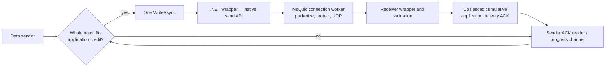

# What limits this single-stream QUIC workload?

Application feedback and write granularity both matter. Increasing application credit
improved QUIC throughput by a median paired 8.00%; doubling application write size at
that larger credit improved it by another, separately controlled 4.47%. SslStream
benefited more in both comparisons. QUIC remained slower on this Linux loopback host.
The residual limit is consistent with a heavily occupied native connection worker
performing packet crypto, protocol and I/O work. Copies contribute visible work;
these measurements do not assign them a percentage of the throughput gap.

This investigation ran on **2026-11-11 UTC** with both endpoints actually loading
**.NET 10.0.14**, and QUIC endpoints loading **MsQuic 2.6.3**. It is separate from the historical
[88-attempt study](RESULTS.md) and [96-attempt .NET 10/11 comparison](RUNTIME_COMPARISON.md).
Those datasets are unchanged. No actor framework, HTTP or Akka Streams runs are
included here; these figures must not be labeled Artery transport performance.

## Workload and controls

One persistent bidirectional stream/connection, mutual TLS 1.3, AES-128-GCM, validated
348-byte payload plus eight-byte sequence header. Framed application bytes are 356 per
frame; decimal GB/s excludes IP/transport overhead. Both transports use the same
controller, operation cancellation, bounded outstanding application credit, cumulative
application delivery ACKs, final delivery confirmation and phase fences. Setup and
teardown are outside steady state. Exactly one public data WriteAsync is pending.
Warmup is two seconds and measurement six seconds, on the same connection.

|Cell|Cap B|Frames/write|Actual bytes/write|Window frames|Credit B|ACK boundary|
|---|---:|---:|---:|---:|---:|---:|
|A|65,536|184|65,504|1,280|455,680|1,104|
|B|65,536|184|65,504|5,120|1,822,720|1,104|
|C|131,072|368|131,008|5,120|1,822,720|1,104|

The ACK-every-ten-frame trigger coexists with boundary 1,104. The reverse writer
coalesces progress, so equal trigger rules do **not** imply equal ACK record counts.
`attempts.csv` includes actual ACK records/s and frames per actual ACK.

Each primary block contains QUIC/TLS and TLS/QUIC pairs (`--rounds 2`). E04 uses
A/B/B/A; E05 uses B/C/C/B. Each cell has four observations per transport, none
excluded. Pairing a candidate block's first/second observation with the corresponding
nearby control block's first/second observation gives the four reported changes;
this is temporal ordinal matching, not simultaneous execution or randomization.
All metrics are calculated per attempt before aggregation. The median paired change
and ratio of independent medians are deliberately reported separately.

## Primary results

These are **progress-off, allocation-diagnostics-off, profiler-off** results from the
same new application binary. Mframes/s means million frames per second.

|Experiment|Transport|Control → candidate Mframes/s (median)|Framed GB/s (median)|Median paired throughput change|Ratio of FPS medians|CPU ns/frame (median)|
|---|---|---:|---:|---:|---:|---:|
|E04 A → B: application credit only|QUIC|5.483 → 5.937|1.952 → 2.113|+8.00%|+8.26%|1,057 → 970|
|E04 A → B|SslStream|6.356 → 7.380|2.263 → 2.627|+17.07%|+16.11%|1,042 → 876|
|E05 B → C: application write size only|QUIC|5.931 → 6.196|2.112 → 2.206|+4.47%|+4.47%|958 → 837|
|E05 B → C|SslStream|6.739 → 7.531|2.399 → 2.681|+11.97%|+11.75%|921 → 849|

All four throughput changes in each row are positive; candidate throughput ranges
sit above control ranges. Combined CPU/frame declines too. Full points, min/max,
paired differences, endpoint CPU, application read/write counts and byte rates are in
[measurements.json](results/causal-investigation/measurements.json),
[summary.json](results/causal-investigation/summary.json), and
[attempts.csv](results/causal-investigation/attempts.csv). B's different results in
E04 and E05 show why contemporary controls matter on this nondedicated desktop.
There was **no direct A-versus-C confirmation**: multiplying gains from separate
comparisons would not be a measured combined result.

The improvements change application policy. A → B allows four times the outstanding
application bytes; B → C doubles the prebuilt batch array from 65,504 to 131,008 bytes
on each endpoint. We did not measure RSS/native peak memory, offered-load tail latency
or fresh managed-allocation gains. Larger saturated batches do not measure batching
dwell time under a lighter offered load.

### Negative and perturbation controls

E02 compared the frozen original binary against the diagnostic implementation with
progress mode disabled, old/new/new/old. QUIC's median paired change was **−2.02%**
(independent-median ratio −2.09%); all four changes were negative. The disabled path
is not free. TLS changes ranged from −17.44% to +9.04%; equivalence was not established
and those drifting observations do not isolate a code cost. All later comparisons use
the same new binary, avoiding attribution of this compatibility tax to credit/batching.

E03 off/on/on/off quantified enabling diagnostics at A: QUIC median paired −0.48%
(independent-median ratio −0.74%); TLS +2.00% with mixed signs. Four observations per
transport/mode do not establish zero perturbation. Diagnostic throughput is never a
primary speed claim. The earlier cancellation experiment's allocation reduction was
not repeated and is not presumed to improve throughput.

## How application credit blocks the sender

Credit is the number of frames sent but not yet acknowledged by the peer application.
Before a write, the sender needs enough credit for its **whole next batch**. If the
outstanding count plus that batch exceeds the configured window, it consumes
cumulative delivery progress until sufficient room exists. A write completion does
not release application credit. Neither does an ordinary QUIC transport ACK.



The diagnostic path records the interval from discovering insufficient credit until
observing enough, plus channel-read counts/readiness. It separately samples data-write
invocation and completion every 64 writes using preallocated histograms. Each
ValueTask is obtained once, inspected once, awaited once. No overlapping QUIC writes,
Task.Run, AsTask or per-operation logging/allocation was added.

[Progress points](results/causal-investigation/progress.csv) show:

|Cell|QUIC credit wait / phase elapsed|QUIC mean sampled observed write|Diagnostic observations/transport|
|---|---:|---:|---:|
|A|41.29–46.26%|17.8–19.94 µs|4|
|B|15.72–17.60%|25.03–25.54 µs|2|
|C|58.18–59.33%|23.79–23.95 µs|2|

B reduces QUIC's observed credit-wait share, supporting a feedback contribution.
C doubles bytes per write with approximately the same observed write duration and
improves uninstrumented throughput: application write granularity matters. C's
credit-wait share rises again; a share of diagnostic wall time is not a decomposition
of uninstrumented capacity. TLS's credit-wait share also rises from A to B despite
better throughput. These counters alone do not identify whether receiver processing,
reverse writes or continuation scheduling delayed progress.

The `creditChannelReadsAwaited` schema field means "not successfully ready at the
explicit snapshot"; every operation is awaited regardless. QUIC data writes were
almost never successfully ready at inspection; TLS writes were all successfully
ready in these diagnostic observations, with their measured invocation accounting for
nearly all observed completion duration. A readiness snapshot does not prove that no
asynchronous work happened before it. An observed write duration includes scheduling;
it is not native send duration or peer delivery latency. Maximum in-flight credit is
not time blocked. An application read is not a UDP packet or syscall.

## Native critical-path investigation

`perf_event_paranoid=4` prevented perf task-clock collection. Instead, E06 used
calibrated gperftools 2.15 CPU timers, a pthread registrar, matching native ELF/debug
symbols and same-run JIT maps, sampled at 100 Hz per thread over an approximately
four-second interior window. Samples × period agree with acknowledged endpoint CPU
within 0.7%. Native, managed, sleep and mixed-thread calibration checked timer coverage,
signal ownership and clean exit. The first calibration target exited successfully,
but its collector incorrectly required timers before preload initialization; that
**rejected collector attempt is retained**, followed by a corrected accepted capture.

Whole-endpoint profiles contain large named yield/spin leaf shares. They could not
establish what a particular native connection worker was doing. E07 therefore mapped
actual connections to worker TIDs with MsQuic LTTng events, before and after a quiet
interval. E08 filtered CPU sampling to each identified worker, disabled hot flow/mapping
channels during sampling, and checked identity/no migration afterward. A six-phase
calibration verified native-only and managed-only filters with both burners active:
99 selected samples each, zero opposite burner samples, matching selected-thread CPU.

|E08 identified QUIC worker|Sender|Receiver|
|---|---:|---:|
|One logical CPU occupied, /proc thread accounting|98.42%|92.57%|
|Samples|395|374|
|Sample CPU / selected thread CPU|3.95 / 3.94 s|3.74 / 3.73 s|
|OpenSSL module leaf share|25.57%|30.75%|
|MsQuic module leaf share|21.52%|22.99%|
|Named memcpy/memmove leaves|38 (9.62%)|48 (12.83%)|
|Named libc allocation/free leaves|9 (2.28%)|0|
|Named yield/spin leaves|0|0|
|Unresolved or ambiguous|7.85%|9.89%|

**Copy/allocation/name categories overlap module counts and cannot be added to them.**
They count interrupted leaf PCs matching explicit regexes in `analyze_causal.py`, not
inclusive cost or allocation/copy volume. Inlining and unresolved samples remain limits.
One filtered capture per endpoint and ~400 samples provide coarse attribution.
OpenSSL AES-GCM encrypt/decrypt loops are visible; `sendmsg` leaves account for 16.20%
of sender and 7.75% of receiver samples. CPU timers charge user+system CPU but do not
provide kernel stacks: system work can land at a userspace return PC. We cannot assign
that time to individual kernel routines or explain all off-CPU intervals.

E06's QUIC hot native threads already occupied 97.93%/91.10% of one CPU; the busiest
observed TLS threads were 38.97%/32.52%. E07 independently identified QUIC's actual
workers at 97.68%/89.70%. This supports a native single-connection worker capacity
constraint; aggregate CPU/frame alone obscured it. It does not prove the entire TLS
kernel critical path or show that scheduler policy changes would help.

### Native flow, copies and packetization

E07 decoded 117,600 events with zero discarded events. Its **151.97 ms** hot trace
window associated 4,628 data sends of 65,504 bytes with native completion:

|Data-send transition|Mean|p50|p99|
|---|---:|---:|---:|
|Native API entry → queued on connection worker|16.71 µs|15.45 µs|43.30 µs|
|Queued → native SEND_COMPLETE indication|2.53 µs|2.83 µs|5.81 µs|
|Completion → next native send API entry|13.59 µs|7.25 µs|70.83 µs|

The last interval includes application credit/preparation, wrapper copying and
continuations; it is not a pure continuation latency. Native SEND_COMPLETE returns
buffer ownership under default send buffering, not peer application delivery. Reverse
16-byte ACK sends had mean 16.51 µs API-to-worker and 0.284 µs queue-to-complete.

The trace observed receive virtual-window growth from 128 KiB through **8 MiB**.
Connection flow state was known for 99.996% of the hot window; sender stream state for
85.757%. No transport credit, pacing or congestion blocking appeared in those known
intervals. The initial unknown intervals prevent an all-time absence claim. Blind
initial-window increases are not selected by this evidence.

Receiver pause/start transitions occurred 2,036 times each; paused residence was
35.38%, started 53.07%, initially unknown 11.55%. This establishes receive staging
interaction, not its throughput penalty. Offered native receive bytes can reoffer
unaccepted data: 2.620 GB offered versus 303.010 MB accepted is neither network bandwidth
nor measured copy volume.

**GSO/GRO is active**, not inferred absent from low throughput. Dominant native UDP
sends/receives were 64,768 bytes with 1,472-byte segments. Send BufferCount 44 counts
logical packet buffers, not 44 syscalls; the deployed source uses one iovec for a GSO
buffer. Loopback MTU was 65,536. There is no hardware NIC inference. MsQuic declared
45 packets lost over the E07 capture, none in its hot flow window; E08 declared 1,234
while profiling. These are FACK/RACK loss declarations, not physical-drop counts or
primary-run loss rates. The difference is a perturbation warning, not a tuning result.
E08 decoded 10,334 events with zero discarded events.

## Source facts versus attribution

These mechanisms were checked against the deployed versions. They are explanations
to test, not percentages of this benchmark's gap:

- [.NET 10 QuicStream](https://github.com/dotnet/runtime/blob/v10.0.14/src/libraries/System.Net.Quic/src/System/Net/Quic/QuicStream.cs)
  rejects overlapping public writes. Its
  [MsQuicBuffers](https://github.com/dotnet/runtime/blob/v10.0.14/src/libraries/System.Net.Quic/src/System/Net/Quic/Internal/MsQuicBuffers.cs)
  allocates/copies each nonempty write's native buffer and frees it on send completion.
  Those allocations are outside managed GC allocation counters.
- [MsQuic send buffering](https://github.com/microsoft/msquic/blob/v2.6.3/docs/Streams.md#sending)
  adds internal storage/ownership behavior. Disabling it changes completion semantics
  and requires live buffers and adequate pending native sends; it would not be an
  isolated copy optimization under the existing single-send assumption.
- [.NET receive staging](https://github.com/dotnet/runtime/blob/v10.0.14/src/libraries/System.Net.Quic/src/System/Net/Quic/Internal/ReceiveBuffers.cs)
  is locked and capped at 64 KiB, with native-to-staging and staging-to-caller copies.
  This fixed wrapper cap is distinct from the growing native transport window.
- [Reusable task source](https://github.com/dotnet/runtime/blob/v10.0.14/src/libraries/System.Net.Quic/src/System/Net/Quic/Internal/ResettableValueTaskSource.cs)
  requests asynchronous continuations;
  [registration](https://github.com/dotnet/runtime/blob/v10.0.14/src/libraries/System.Net.Quic/src/System/Net/Quic/Internal/MsQuicApi.cs)
  selects LOW_LATENCY internally. There is no public QuicConnectionOptions profile switch.
- [MsQuic execution](https://github.com/microsoft/msquic/blob/v2.6.3/docs/Execution.md)
  serializes a connection's protocol work on one worker at a time. Multiple streams
  on one connection do not automatically provide more protocol worker cores.
- [Linux datapath](https://github.com/microsoft/msquic/blob/v2.6.3/src/platform/datapath_epoll.c),
  [feature detection](https://github.com/microsoft/msquic/blob/v2.6.3/src/platform/datapath_linux.c),
  and [receive window growth](https://github.com/microsoft/msquic/blob/v2.6.3/src/core/stream_recv.c)
  explain the trace fields above. TLS record and QUIC packet protection have different
  granularities even with the same negotiated AES-128-GCM suite.

The historical [.NET send-buffer discussion](https://github.com/dotnet/runtime/issues/73691)
includes a prototype regression, a useful caution that eliminating a copy need not
improve end-to-end throughput. It is not evidence of the deployed version's cost.
SslStream also has copies, allocation, native crypto and scheduling; no zero-cost
baseline is assumed.

## Reproduce or inspect

Public evidence validation requires Git history and Python, not running endpoints:

```sh
python3 analyze_causal.py
python3 -m unittest test_progress.py test_causal.py
python3 analyze_results.py
python3 analyze_comparison.py --published results/runtime-comparison/measurements.json
```

Application source is `cbceae8f322ab4da603f7bff6e4419fd78667325`; frozen
`TransportSpike.dll` SHA-256 is
`3022bea461e9af1f8a00eecf9e9e2beb6a5ea1f498e6319208359e8a8c4b827f`.
Later commits add profiling/report tooling without changing this application.
E02's old frozen binary is `4df93f59b1cc2f908d23faa9a57aec939b96a1a152342eea6455fe472d3406bf`.
Its retained local descriptor names an earlier amended revision; its C# hashes match
the public `credit-ack-workload-v1` tag. That public source relationship is **not** a
claim that rebuilding an amended tag reproduces the old binary byte-for-byte.

For fresh measurements, first follow [setup and security/native pinning](README.md#run-locally).
Use a clean source checkout/worktree; never change pins/identity within comparisons:

```sh
dotnet build -c Release
python3 prepare.py
python3 freeze_build.py causal-reproduction
python3 run_spike.py check evidence/new-check --build builds/causal-reproduction/TransportSpike.dll --ack-boundary 1104
python3 run_spike.py run evidence/new-A1 --build builds/causal-reproduction/TransportSpike.dll --rounds 2 --payload 348 --batch 65536 --window 1280 --ack-boundary 1104
python3 run_spike.py run evidence/new-B1 --build builds/causal-reproduction/TransportSpike.dll --rounds 2 --payload 348 --batch 65536 --window 5120 --ack-boundary 1104
python3 run_spike.py run evidence/new-B2 --build builds/causal-reproduction/TransportSpike.dll --rounds 2 --payload 348 --batch 65536 --window 5120 --ack-boundary 1104
python3 run_spike.py run evidence/new-A2 --build builds/causal-reproduction/TransportSpike.dll --rounds 2 --payload 348 --batch 65536 --window 1280 --ack-boundary 1104
```

E05's B/C/C/B sequence uses the same B settings; C changes only `--batch 131072`.
Run progress diagnostics separately with `--progress-diagnostics`; do not mix their
rates into primary timing. All original block settings, temporal order, source/binary
and raw-log hashes are retained in the exported block ledger. Exported commands
reconstruct portable paths; the contemporaneous private journal retains literal commands.

The explicit A/B/C correctness cells use 8,193 frames, exceed credit, and end with a
partial batch. They run both transports, progress on/off, with delivery/cancellation,
abort, corruption and parameter-agreement gates. The investigation completed 60
correctness cases plus three invalid sampling-bound checks. All 80 transport attempts
were valid and retained: 56 uninstrumented, 16 progress diagnostic, and eight native
capture/context attempts. No fastest-run selection or timing exclusions.

See [native capture instructions](tools/NativeProfile/README.md). Whole-process
profiling and the six-phase calibration driver ran as published. Portable LTTng and
filtered-worker capture scripts substitute explicit installation paths for the private
recorders; they were source-reviewed and CLI-checked, **not rerun as new captures**.
Both public decoders exactly replayed the original captures. Keep that validation limit
visible rather than treating a portable transcription as a second reproduction.

The [environment ledger](results/causal-investigation/environment.json) records actual
loaded native/managed hashes, runtime, GC, affinity, CPU/kernel and interface facts.
The Ryzen 9 9900X host had 24 logical CPUs, powersave governor, no dedicated CPU
isolation, and unrelated desktop activity. Primary load snapshots are in each block.
Timing, builds, profiling, analysis and Memorizer writes were serialized for our owned
work; absence of all unrelated host work is not claimed.

Raw logs, maps, CTF and symbols contain private process/host details and are not
published. Public hashes preserve provenance but cannot make unavailable raw artifacts
independently auditable. `export_causal.py` requires the retained local captures and
writes only a fresh output directory; public arithmetic/source replay uses
`analyze_causal.py` without those private artifacts.

## Decision and remaining question

Keep opt-in diagnostics and the controlled credit/batch findings. Do not infer that
managed allocation reduction, missing UDP offload, a fixed native 64 KiB window, or
global yield/spin alone explains the gap. Copies and receive staging are real and
visible, but their causal penalties remain unmeasured. The identified native worker
has little spare CPU, with substantial packet crypto/protocol/I/O work.

The next consequential test, if this single-stream question merits more runtime work,
is a controlled custom-runtime LOW_LATENCY versus MAX_THROUGHPUT registration
comparison, retaining the stock runtime, workload, encryption, batch, credit and ACK
rules. This would test native scheduling/batching tradeoffs; it is not an exposed
public option and was not implemented here. A matched native wrapper control could
subsequently isolate wrapper costs, but a different secnetperf protocol cannot be
subtracted to obtain a measured wrapper penalty. Multi-stream, two-host and impaired
network studies belong to separate workload questions.

[Blog research outline and claim ledger](BLOG_RESEARCH.md) accompany this evidence
packet. Publication is a separate step.
