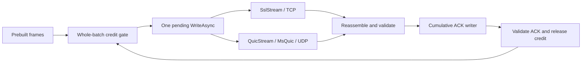

# Initial results and methodology

These measurements were collected on2026-11-11 using .NET10.0.14, SDK10.0.403 and
MsQuic2.6.3 on Linux localhost. The CLI host reported11.0.0-rc.3; both application
processes explicitly reported runtime10.0.14. ServerGC and TieredPGO were enabled.
A CPU/kernel snapshot collected during publication is in `results/environment.json`;
it was not captured separately in every original attempt. Results are single-host,
single-stream observations and do not establish an intrinsic QUIC ceiling.

## Common protocol and controls

One persistent full-duplex connection per client/server process pair. QUIC uses one
bidirectional stream. TLS uses one NetworkStream/SslStream. Both negotiate mutual
TLS1.3, TLS_AES_128_GCM_SHA256, the same ALPN and pinned test identity. The client
checks hostname. TCP NoDelay=true; other socket/native defaults remain unchanged.
There is no scheduler tuning. Neither arm uses HTTP or an actor framework.

A frame has8B of sequence and a deterministic payload. The receiver checks every byte
and exact order. Both arms submit identical fixed data batches, except the last partial
batch in fixed-count correctness tests. Exactly one write is pending per direction.
Buffers are preallocated and reused only after write completion. Logical credit is
released only by valid cumulative receiver ACKs. Sender credit is reserved before
submission because ACKs can arrive before an await continuation resumes.

Warmup and measurement share the connection. A terminator, final ACK, client
confirmation and server Done fence the phase. Connection close is not delivery proof.
Handshake, setup, warmup and teardown are outside the measured interval. Client elapsed
time includes final validated delivery and local write drain, rather than dividing by
nominal6s. Server phase CPU starts after Ready write settles and ends after final ACK
write settles; client CPU starts after reading Ready and ends after data writer/final
ACK settle. These boundaries differ slightly. CPU per frame sums separate processes.
GC counters measure managed allocation, not native malloc/copies, RSS or peak occupancy.
The protocol itself includes framing, payload comparison, Channel wakeups and one
Stopwatch check per data batch; measurements do not isolate native costs mathematically.

## ACK policy and controlled discovery

The original policy requested progress every10frames OR every data-batch boundary.
With one-frame writes this requests ACK progress every frame. Actual reverse records
are coalesced while an ACK write is pending, so counts differ between transports.
Original Q/T comparisons are matched within each cell, but cross-cell gains couple
data batching and ACK policy. Do not attribute those gains solely to data writes.

The revised boundary1104 is divisible by1,46and184 and fits the1280-frame window.
Together with the same10-frame threshold it holds ACK triggers fixed across these
batch sizes and preserves progress when the sender waits for a complete batch's credit.
Default0 retains the original policy. Actual coalescing can still differ by transport.

|Discovery,348B payload, shared boundary1104|Data write bytes|QUIC frames/sec|TLS frames/sec|
|---|---:|---:|---:|
|One frame|356|261,983|313,532|
|16KiB cap /46frames|16,376|4,089,202|6,164,532|
|64KiB cap /184frames|65,504|5,593,341|7,415,610|
|64KiB /phase-lifetime cancellation|65,504|5,561,670|7,319,668|

Each cell has four sequential reversed Q/T pairs,2s warmup+6s measurement. Logical
credit remains1280frames=455,680B. Larger writes amortize both transport and common
application work. These cells provide the cleaner batching comparison. TLS was measured
with each policy; no old TLS number substitutes for a contemporary control.

## Confirmation and larger payload

Confirmation alternated original,candidate,candidate,original blocks. Each block had
two reversed Q/T pairs, giving four runs per transport per policy. The candidate changes
both16→64KiB data cap AND original→shared ACK boundary. This confirms the combined
policy, not an isolated35% native-write optimization.

|348B payload confirmation|QUIC frames/sec|TLS frames/sec|Combined CPU ns/frame Q/T|
|---|---:|---:|---:|
|Original policy|4,149,851|5,714,277|1,588.8 /1,212.3|
|Candidate policy|5,617,568|7,214,781|1,011.1 /981.4|

QUIC improves35.36795%; TLS improves26.25885%. Candidate QUIC is22.13806% below TLS
by ratio of medians. Its per-pair deltas are[-22.87,-13.53,-27.19,-19.27]%, whose
median is-21.0730%: this is a different statistic. Host variation is visible, especially
in TLS. All candidate Q rates (5.481–5.728M) exceed all surrounding original Q rates
(4.078–4.252M); every candidate Q/T pair still favors TLS. No fastest-run selection.

The4KiB payload sanity cell gives492,814 Q versus844,333 TLS frames/sec, or2.01856
versus3.45839 decimalGB/s of payload: Q is41.6328% lower. It uses4104B frames,
15frames/write=61,560B,111framecredit=455,544B and common ACK boundary105. Whole-frame
credit is136B below the348B cell's byte budget. Two reversed pairs only. This larger
gap is retained; there is no universal22% penalty. Similar Q bandwidth around2GB/s in
these cells is a profiling lead, not evidence of a hard bandwidth ceiling.

## Allocation and latency

Separate allocation-diagnostic attempts are excluded from primary throughput claims.
The table shows combined managed bytes allocated per validated frame across both ends.

|Policy|QUIC B/frame|TLS B/frame|
|---|---:|---:|
|Original16KiB /operation tokens|7.12–7.65|1.16–1.21|
|64KiB /fixed ACK /operation|2.994–3.000|1.604–1.673|
|64KiB /fixed ACK /lifetime|1.806–1.812|1.434–1.466|

The combined64KiB/fixed-ACK policy reduces Q managed allocation about59%; cancellation
reduces it another40%. The latter has no demonstrated speed win (Q-0.57%,TLS-1.29%
in discovery). Operation tokens remain the confirmation policy. Lifetime mode retains
bounded transport abort on phase/global failure and cancelable credit waits. It is an
allocation experiment, not a general production cancellation recommendation. TLS
allocation did not improve with larger batches in this sample.

Original window1 cases submit one frame under either nominal cap. Sampled median
acknowledgment RTT is about21–24us for Q and11–13us for TLS; p99 about45–50us versus
18–25us. Every required sample, taken every64th frame, is present. This is closed-loop
application ACK latency, not matched-offered-load actor latency. Equivalent sequential
cells varied; do not infer a batching-cap effect when actual writes are both one frame.

The64KiB prebuilt buffer is4x the16KiB buffer. It can increase retained/native occupancy
and burstiness. No batch dwell-time model, offered-load tail latency, lower-RSS claim,
LAN/loss/congestion evaluation, multi-lane evaluation or production default follows.
Q application data reads were larger/fewer than TLS in the original16KiB case (~19–20KB
versus16,376B), while Q remained slower. These counters do not count UDP packets or
native syscalls. ACK reads count decoded16B records, not underlying ReadExactly calls.

## Provenance and verification

The sanitized export includes all16 blocks /88 valid performance attempts:
76 uninstrumented and12 diagnostic. No invalid performance attempts were excluded.
Accepted original native correctness comprises34 cases:14 positive and20 intended
corruption/pin/abort failures. Earlier28 development checks are outside this acceptance
ledger, including an initially unintended SDK11 compiler selection corrected before
frozen performance runs. They are not timing evidence. Local publication smoke checks
are a separate packaging check and are not added to the88 original measurements.

The C# files at the two workload tags match the measured baseline and candidate source
hashes. Source hashes come from frozen build descriptors where available, rather than
from a later controller worktree. Portable preparation/controller scripts replace local
research dependencies. Original logs, binaries, identities and machine paths are not
published. Original log/source/native/binary SHA256 values retain provenance. The first
16KiB block predates an embedded frozen descriptor and used manual reconciliation plus
retained hashes; later blocks used automated before/after descriptor gates.

Original source and evidence were independently reviewed, including all raw phase and
security witnesses, counts, ordering, source/binary/native/log hashes and derived metrics.
An independent offline replay reproduced all16 summaries. Nine corrupted-evidence controls
rejected missing completion/row, false throughput/CPU/allocation/payload rate, altered
phase/security witness and altered log. Build had0warnings/errors; Slopwatch0issues.
Benchmarks, builds, tests and profiling did not overlap.

`analyze_results.py` lets readers recompute the published arithmetic and coverage without
private artifacts. `summarize.py` audits fresh local raw runs against their logs and local
libraries. Public sanitized data cannot reproduce raw-log checks against unavailable
original logs; hashes alone do not provide that proof. New results must be labeled with
their own environment and source revision.

A gap without an actor/streaming framework rules out blaming the whole result on that
framework. It does not distinguish .NET QUIC wrappers, MsQuic, UDP/kernel work, encryption,
packetization, native allocation/copies, syscall batching or wakeups. Those remain
profiling questions. Allocation alone is insufficient: reducing it did not independently
improve speed. Further application engineering should follow attribution, with matching
controls and separate uninstrumented timing.
